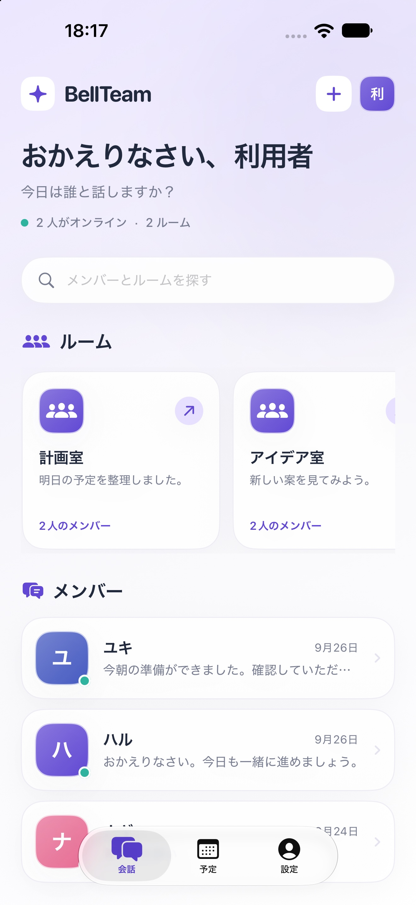
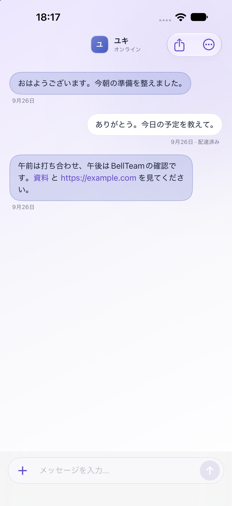

[BellTeam](https://kitepon.dev/products/bellteam/)のiPhone・iPad版を[App Store](https://apps.apple.com/jp/app/bellteam/id6816295589)で配信しています。10月19日にはバージョン1.0.1を公開しました。Mac版は審査中です。

BellTeamは、自分のマシンでAIのチームを持てるアプリです。私がこれまで作ってきた道具の集大成に近いものなので、今回は少し長めに書きます。前半で何ができるかを紹介して、後半で作った経緯と仕組みを書きます。

## 自分のマシンで、AIのチームを持てます

BellTeamでは、AIのメンバーを何人も置けます。メンバーごとに名前と担当する仕事を決めて、個別のチャットで話したり、何人かのメンバーとルームで話したりします。画像を添えて頼むこともできます。

メンバーはプロダクトや仕事ごとに置きます。担当を決めておくと、メンバー同士が必要に応じて連絡を取り合って仕事を進めます。私はその様子をiPhoneから見て、必要な時に話しかけます。

予定も入れられます。一度だけの予定のほか、毎日、曜日ごと、何時間おきといった繰り返しも選べます。決まった時間になると、メンバーがその仕事を始めます。

## AI同士を会話させることに、ずっと興味がありました

AIを始めた頃から、私はAI同士を会話させることに興味がありました。その興味に沿って、いくつも道具を作ってきました。

最初は、Discordから自分のClaude Codeを動かす[AIアシスタント]()でした。そこに[記憶と人格を持たせて]()、秘書のベルが生まれました。

そのあと、会話の続きを引き継ぐ[Throughline]()を作りました。AIに永続的なターミナルを持たせる[Aiterm]()を作ってからは、[ClaudeがCodexを動かして]()、[AI同士が会話して作業を進める]()使い方ができるようになりました。工程を並べて配る[Lattice]()と、席同士が相談して進める[Peertable]()も作りました。

こうして基盤になる道具が揃ってきたので、それらを活かしてBellTeamを作りました。BellTeamのメンバーは基本的にAitermの上で動いていて、Throughlineも使っています。

## 一つのOSSを、いくつものOSとハーネスに合わせたいと考えていました

もう一つの理由は、自分のOSSの対応作業です。私は一つのOSSを、Mac・Windows・Linuxと、Claude Code・Codex・Grok・Cursorのようなハーネスのそれぞれで動くようにしたいと考えていました。

これまでは複数の環境を行ったり来たりしながらOS対応を進めていました。シーソーのように片方が直れば片方が壊れますし、バージョンアップのたびに作業量が増えていきました。

BellTeamのメンバーはAitermで動いていて、Aitermは他の端末のエージェントを起こせます。私はこれを使って、各OSの端末で動くエージェントに作業を任せています。BellTeamは、複数のOS対応をスムーズに進める拠点になっています。

最近の例を三つ書きます。

- **Throughline（10月15日）：** Windowsでだけ、会話の記録を保存する処理が失敗していました。Throughlineの担当メンバーがWindowsで失敗を再現して原因を切り分け、修理版を公開してWindowsの端末を更新しました。そのあと、普段の使い方で記録が正しく残ることまで確かめています。
- **Caveat（10月15日〜16日）：** 修正がMacとLinuxで通っても、Windowsで失敗している間は取り込まずに待ちました。担当メンバーがWindowsを直し、別のメンバーの確認を受けてから取り込み、Mac・Linux・Windowsの試験がすべて通ったことを報告してきました。
- **testgate（10月16日）：** 不具合の調査と修理を担当メンバーが受け持ち、検証と公開は別の担当に分けました。最後に配布担当が、MacとWindowsを含む各端末へ修理版を入れて、結果を返しています。

私が各環境を行き来して結果を揃える代わりに、担当のメンバーがその環境で直して、確かめて、配るところまで受け持っています。

## 私はこう使っています

多OS対応のほかにも、仕事ごとにメンバーを置いています。

- **バグの片付け：** 各プロダクトのバグの記録を一か所に集めて、それを直す仕事をプロダクトごとの担当に割り当てています。担当はほかのメンバーと連絡を取りながら、毎日それを片付けていきます。
- **セキュリティの一斉点検：** サーバー、コンテナ、アプリ、GitHub、外部サービスのアカウント設定を、点検の担当で分けて調べます。見つかった問題は直す担当に回して、直ったかを点検の担当が確かめます。
- **秘書：** 秘書のメンバーは、私の頼み事を整理して担当へ聞きに行きます。たとえば、あるアプリがどこまでできているかを、そのアプリの窓口の担当に聞いて、できている所と残っている所を分けて報告してくれました。私が二人の会話を取り次ぐことはありませんでした。

私が判断する所は、[Approval Box]()でスマホに届くようにしています。Approval Boxは別のプロダクトで、BellTeamと組み合わせて使っています。

## 強いところ

ここからは、BellTeamの仕組みで気に入っている所を書きます。

### メンバーごとに、ハーネスとモデルを選べます

メンバーを作る時に、Claude Code・Codex・Grok・Cursorの中からハーネスを選び、そこで使えるモデルを選びます。作った後でも変えられます。ハーネスを変えると、そのメンバーのセッションを起こし直します。

選べるモデルは、それぞれのCLIが対応している範囲と、自分のAIサービスの契約の範囲で決まります。仕事の重さに合わせて、メンバーごとに使い分けられます。

### ルームでは、返事をするメンバーを決められます

Peertableを作った時、困ったことが二つありました。AIには黙るという返し方が無く、何か言われると必ず返事をします。宛先の無い話が流れると、その仕事に用の無い席まで動き出します。

BellTeamのルームでは、発言ごとに返事をするメンバーを指定できます。指定されていないメンバーは、話の内容を把握したうえで、発言をせずに終えます。この指定は最初から使えます。TypeSafeのAPIキーを設定すると、返事をするメンバーを自動で選ぶこともできます。

### 通話ブリッジを足せば、外のAIとも話せます

通話ブリッジを追加で設定すると、BellTeamの外で動いているAIともメッセージをやり取りできます。同じマシンで動いている別のエージェントや、[Grok Bot](https://x.ai/news/introducing-grok-bot)とも連携できます。BellTeamのメンバーは、相手の名前を電話帳から探して話しかけます。

これは追加の機能なので、手間がかかります。ブリッジを別に設置して、接続先と認証、相手の電話帳、着信の経路を設定します。

## Grok Botが先に出ました

BellTeamを作っている最中に、xAIのGrok Botが公開されました。2026年8月11日のことです。

自分で手を入れられる人にとっては、BellTeamの方が自由があると思います。ハーネスとモデルをメンバーごとに選べますし、サーバーは自分のマシンで動いていて、中身も公開しています。

## 始め方と料金

BellTeamのサーバーは、自分のマシンで動かします。DockerとComposeが使えるMac、Windows（WSL 2）、Linuxのどれかに設置します。AIは、それぞれのAIサービスの自分の契約で認証して使います。サーバーは動かし続けておく必要があります。

同じマシンやLANからは、そのまま接続できます。外出先から使う時は、HTTPSとCloudflare Accessを設定します。設置の手順は[公開リポジトリ](https://github.com/kitepon/BellTeam)の[設置手順](https://github.com/kitepon/BellTeam/blob/main/docs/server-installation.md)にまとめています。起動したら最初に使うAIを選んで公式サイトで認証すると、案内役のメンバーが会話で初期設定を進めます。

サーバーとWebアプリは無料です。Webからは、すべてのメンバーとの会話、メンバー同士の連絡、予定の実行を購読なしで使えます。

iPhone・iPadアプリは、日本では月額300円の自動更新の購読です。アプリの入手、案内役との初期設定の会話、会話の閲覧と書き出しは無料です。初期設定が終わった後の普段の会話と、予定の作成・編集・手動実行に購読が要ります。AIサービスの料金とマシンの運用費は含まれません。

アプリの画面は今は日本語です。問い合わせは[サポート](https://bellteam-subscriptions.kitepon.workers.dev/support)にまとめています。
